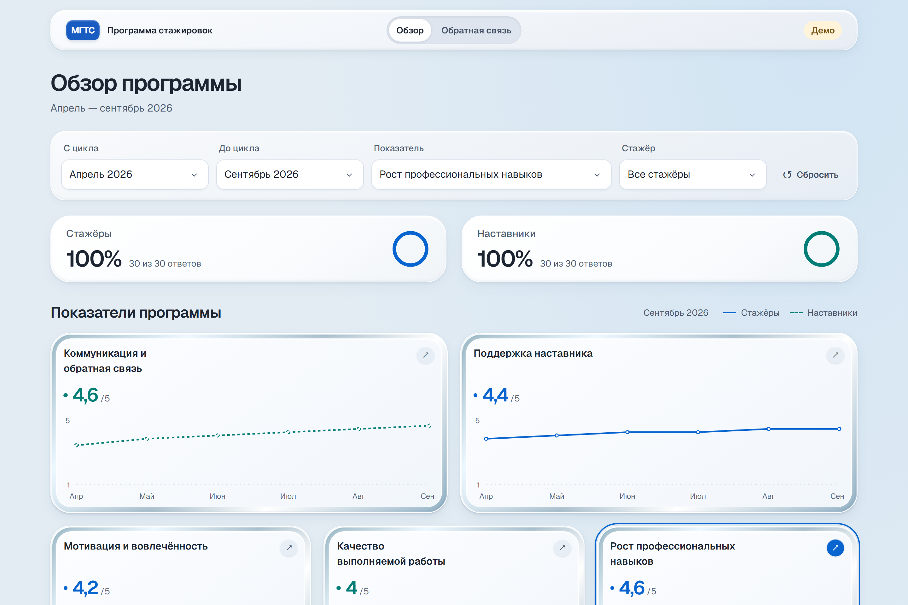
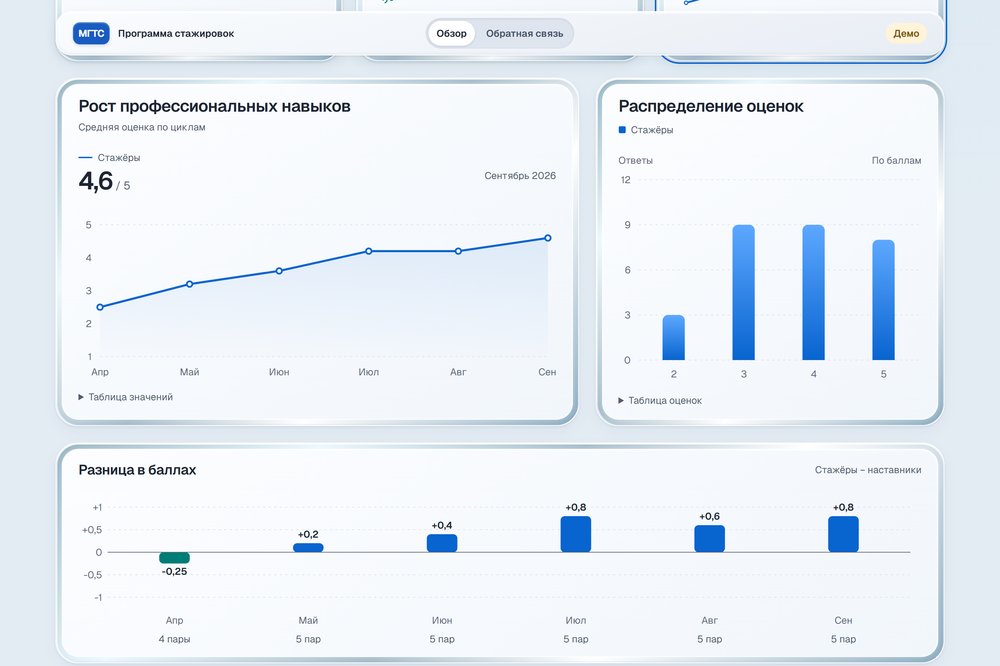
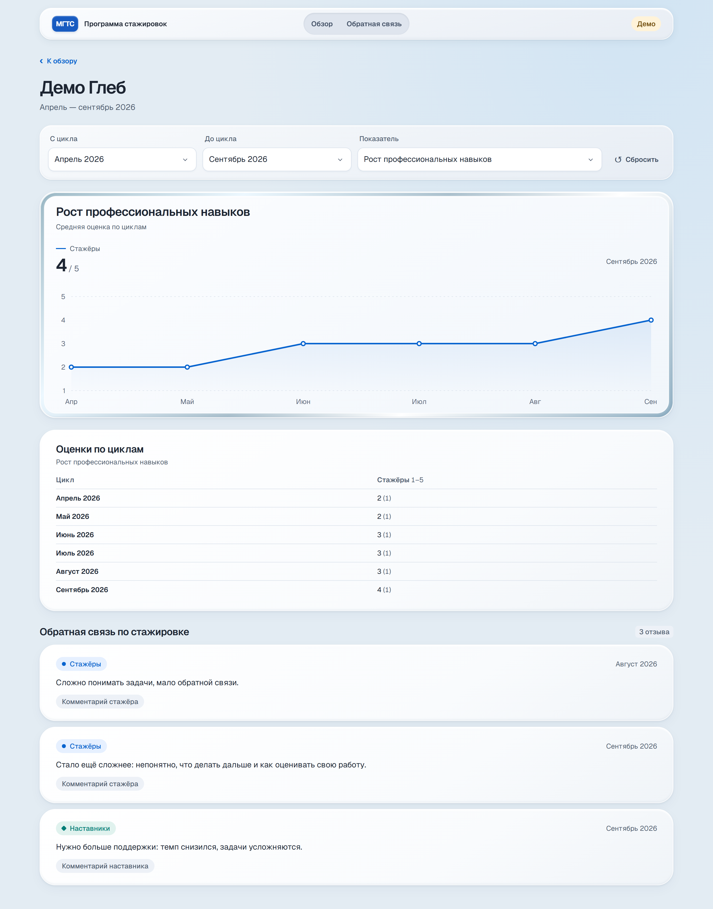
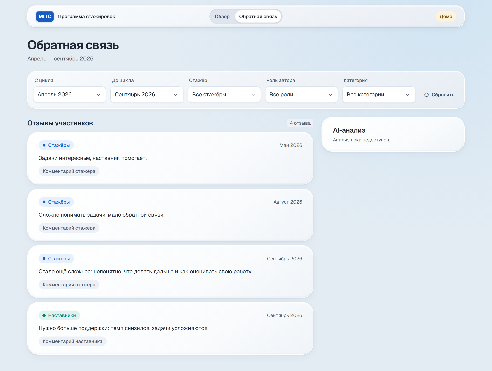
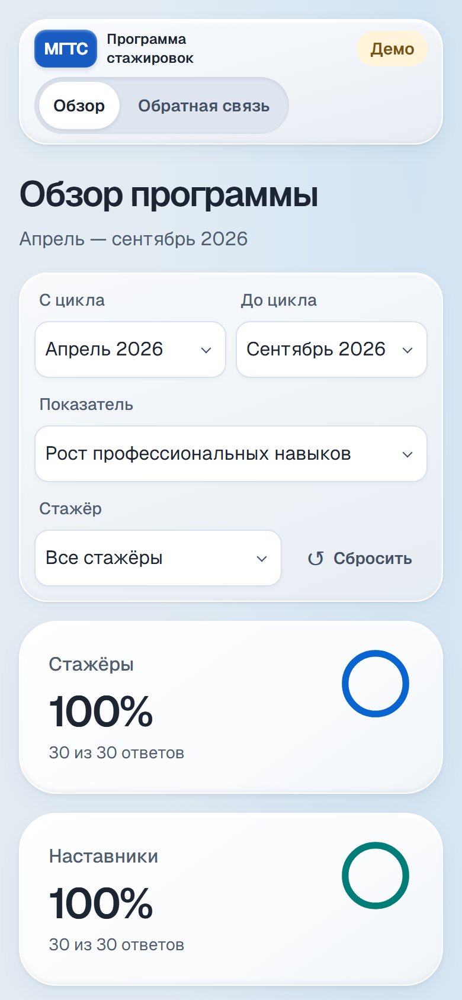

# MGTS HR Dashboard

HR-дашборд для шестимесячной программы стажировок МГТС: охват анкетирования, динамика показателей по шести циклам, сравнение ответов стажёров и наставников и переход от общей картины к карточке конкретного участника.

## Скриншоты

| Обзор: охват + пять виджетов | Детали показателя: динамика, распределение, сравнение | Карточка стажёра с отзывами |
|---|---|---|
|  |  |  |

| Обратная связь | Узкий экран (мобильный) |
|---|---|
|  |  |

Все скриншоты — `docs/screenshots/`. Данные на них — из демо-бэкенда (режим `demo`, синтетический сид).

## Возможности

* **Обзор** — охват анкетирования по ролям и виджеты с динамикой показателей; фильтры по периоду, стажёру и показателю. Выбранный показатель раскрывается в полной детали: подробная динамика, распределение оценок и сравнение двух ролей (направление разницы и число пар).
* **Состояния данных** — пропуск отличается от нулевой оценки; несопоставимые шкалы, отсутствие пар и пустой срез — отдельные состояния, а не «тихие» нули.
* **Карточка стажёра** — его оценки по циклам и доступные отзывы в рамках разрешённого среза.
* **Обратная связь** — комментарии по периоду, роли автора и категории; для AI-анализа предусмотрено состояние «Анализ пока недоступен».
* **Интерфейс** — на русском, в стиле Apple (скруглённые стеклянные панели), адаптивен к узким экранам, управляется с клавиатуры.

## Сюжеты демо (синтетический сид)

* **«Демо Глеб»** — стабильно слабые мотивация и удовлетворённость, низкая поддержка наставника; негативные комментарии в циклах 5–6.
* **«Демо Вера»** — расхождение самооценки и оценки наставника по росту навыков (с цикла 3): блок сравнения показывает устойчивый зазор.
* **«Демо Дарья»** — пропуск оценки роста в цикле 1: NULL, а не 0.

## Стек и архитектура

| Слой | Технологии |
|---|---|
| Фронтенд | React 19, TypeScript, Vite, Recharts, @base-ui/react, liquid-glass |
| Бэкенд | FastAPI, SQLAlchemy + SQLite, Pydantic Settings |
| Данные | `demo` — синтетика без внешних ключей; `real` — Google Forms poller (следующий этап) |

* Контракты фронта и бэкенда согласует адаптер `frontend/src/data/adapter.ts`; типы API, моки и HTTP-клиент вынесены в отдельный слой (`frontend/src/data/`), поэтому реальные источники подключаются без переписывания экранов.
* Расчёты показателей (охват, динамика, распределение, парное сравнение) и правила доступа — на стороне сервера; политики задаются в `backend/config/permissions.yaml`.
* API: `GET /api/v1/meta`, `GET /api/v1/metrics`, `GET /api/v1/feedback` (контракт — комментарии в `backend/app/api/v1/`).

## Быстрый старт (демо)

Бэкенд:

```bash
cd backend
python -m venv .venv && .venv/Scripts/python -m pip install -r requirements.txt   # Linux/Mac: .venv/bin/python
.venv/Scripts/python -m app.scripts.seed_demo --reset                             # 5 стажёров × 5 наставников, циклы 1–6

MGTS_DATA_MODE=demo \
MGTS_PERMISSIONS_PATH="$(pwd)/config/permissions.demo.yaml" \
.venv/Scripts/python -m uvicorn app.main:app --host 127.0.0.1 --port 8000
```

Фронтенд (HTTP-режим, Vite проксирует `/api` на бэкенд):

```bash
cd frontend
npm ci
VITE_DATA_MODE=http API_PROXY_TARGET=http://127.0.0.1:8000 npm run dev
```

Открыть http://127.0.0.1:5173. Без `VITE_DATA_MODE=http` фронт работает на встроенных моках (режим по умолчанию, переключатель сценариев в шапке).

`permissions.demo.yaml` — права для локального демо с включёнными персональными срезами; дефолтный `permissions.yaml`, на который опираются тесты, не меняется.

## Проверка

```bash
cd backend && .venv/Scripts/python -m pytest          # API, каталог, нормализация, сид
cd frontend && npm test && npm run build              # node --test + tsc + сборка
```

## Структура

```
backend/
  app/api/v1/        маршруты /meta, /metrics, /feedback
  app/analytics/     охват, динамика, распределение, парное сравнение
  app/catalog/       каталог анкет/вопросов/метрик из config/catalog.yaml
  app/sources/       источники: Excel-импорт, Google Forms poller
  app/scripts/       seed_demo — синтетическая демо-БД
  config/            catalog.yaml, permissions(.demo).yaml, источники
frontend/
  src/components/    экраны и виджеты (обзор, карточка, обратная связь)
  src/data/          контракт, моки, HTTP-клиент и адаптер бэкенда
docs/screenshots/    скриншоты интерфейса
```

## Следующие шаги

* Загрузка реальных данных из Google Forms (режим `real`, OAuth-скрипт уже в `backend/app/sources/forms_poller/setup_oauth.py`).
* AI-анализ отзывов: OpenAI-совместимый эндпоинт, без ключа — лексиконный fallback.
* Развёртывание сервиса и подключение организаторов программы.
